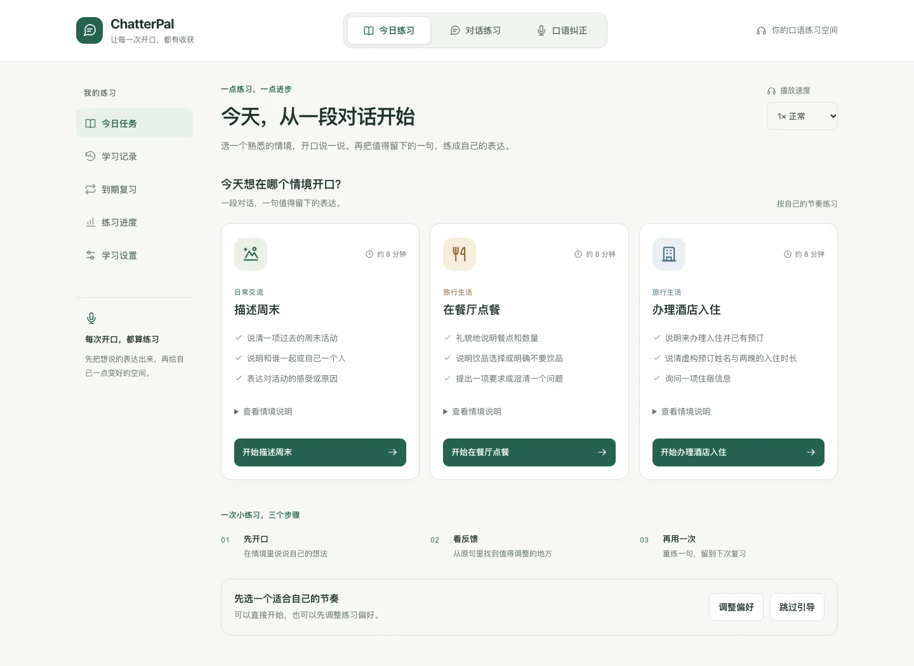
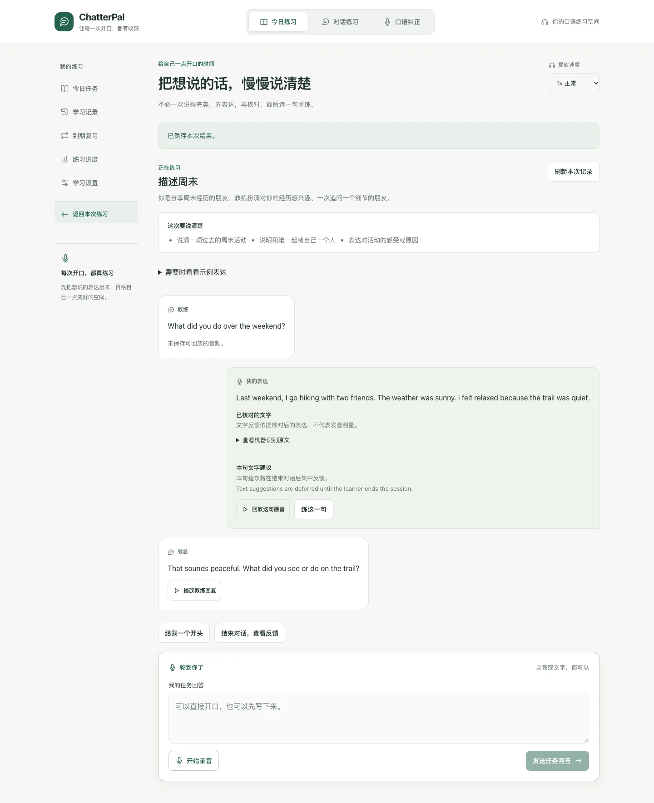
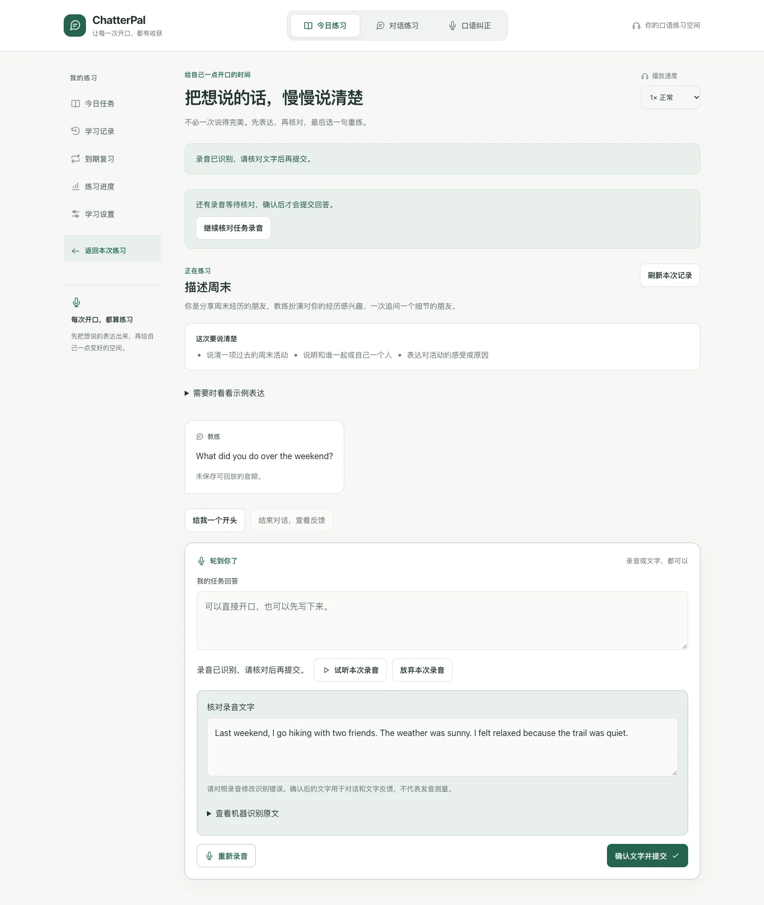
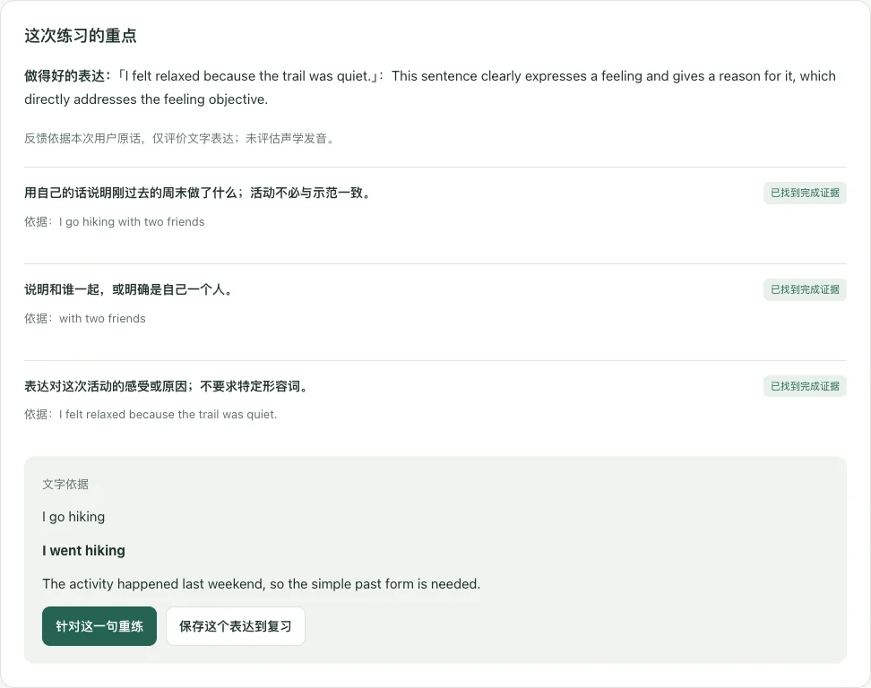

# ChatterPal

**让每一次开口，都有收获。**

ChatterPal 是一个可自行部署的英语口语练习应用。围绕熟悉的生活情境完成一段对话，核对录音文字，查看引用原话的反馈，再把值得留下的一句带到重练和延迟复习中。

[](https://github.com/likebeans/ChatterPal/actions/workflows/tests.yml)
[](https://www.python.org/)
[](frontend/)
[](LICENSE)
[](#项目状态)

[快速开始](#快速开始) · [部署指南](docs/deployment.md) · [开发指南](docs/development.md) · [参与贡献](CONTRIBUTING.md) · [问题反馈](https://github.com/likebeans/ChatterPal/issues)



*当前 React 界面的实际截图；使用演示环境，未包含个人学习记录。*

## 可以做什么

| 功能 | 练习方式 |
| --- | --- |
| 情境对话 | 从「描述周末」「在餐厅点餐」「办理酒店入住」开始，用文字或录音完成多轮对话。 |
| 录音核对 | 先试听、识别并修改转写，再确认提交；任务回答、单句重练和复习均支持此流程。 |
| 原话反馈 | 结束对话后查看任务目标依据和最多两个重点，回看原句并继续重练。 |
| 延迟复习 | 主动保存表达，次日换个问题再用一次；符合独立作答条件时按约 3 天、7 天继续安排。 |
| 历史与进度 | 保存任务、反馈和尝试，支持刷新与 API 重启后恢复、JSON 导出和删除个人数据。 |
| 自由练习 | 另有自由对话、音色选择、回放和参考文本分析；保留独立 Gradio 与终端入口。 |

React + FastAPI 是任务学习主入口。界面支持桌面与移动端，Gradio 提供独立的对话与分析功能。

## 界面预览

以下截图来自实际运行的 React + FastAPI 服务，使用全新的演示学习身份和合成语音。录音由本地 Whisper 识别，对话与文字反馈调用实际配置的 LLM，教练语音由 Edge TTS 生成；截图未包含个人学习记录。

<details>
<summary>情境对话：围绕自己的回答继续聊</summary>



*示例回答和教练追问来自本次运行；可回放原音，也可以选择一句继续练习。*

</details>

<details>
<summary>录音核对：先识别与编辑，再确认提交</summary>



*语音识别完成后仍处于待确认状态。可以试听、修改识别文字、重录或放弃，再明确提交。*

</details>

<details>
<summary>练后反馈：引用原话，保留下一次练习的重点</summary>



*本次示例的文字反馈引用原句，给出过去时建议，并提供单句重练与保存到复习的入口；不代表声学发音评分。*

</details>

## 快速开始

### 1. 准备环境

需要 Git、[uv](https://docs.astral.sh/uv/getting-started/installation/)、Python **3.12** 和 Node.js **20+**。默认安装包含本地 Whisper、Gradio、音频工具及开发依赖。

完整环境还需要原生音频依赖，按系统选择一组命令：

```bash
# macOS（Homebrew）
brew install ffmpeg flac portaudio libsndfile

# Ubuntu / Debian
sudo apt-get update
sudo apt-get install -y build-essential python3-dev portaudio19-dev ffmpeg flac libsndfile1
```

Windows 安装、CPU 专用依赖与不包含本地模型的精简安装，见[部署指南](docs/deployment.md#环境与安装)。

### 2. 安装并配置

```bash
git clone https://github.com/likebeans/ChatterPal.git
cd ChatterPal
uv python install 3.12
uv sync --locked --python 3.12
cp .env.example .env
```

Windows PowerShell 使用 `Copy-Item .env.example .env`。打开 `.env`，为所选服务填写配置。默认组合如下：

| 组件 | 默认实现 | 需要准备什么 |
| --- | --- | --- |
| 语音识别（ASR） | 本地 Whisper `base` | 首次使用时下载模型；无需云端 ASR 密钥。 |
| 对话与文字反馈（LLM） | 阿里百炼 `qwen-plus` | 在 `.env` 中填写 `DASHSCOPE_API_KEY`。 |
| 语音合成（TTS） | 在线 Edge TTS | 可访问对应网络服务。 |

也支持 Aliyun NLS ASR、OpenAI 兼容聊天接口和 CosyVoice TTS。兼容聊天接口需要设置 `LLM_PROVIDER=openai`、`OPENAI_API_KEY` 和模型名；自定义 `OPENAI_BASE_URL` 必须是完整的 chat-completions URL。完整字段见 [`.env.example`](.env.example) 与[提供商配置](docs/deployment.md#提供商配置)。

进程环境变量优先于 dotenv 文件；可以通过 `--env-file` 选择配置，也可以完全使用环境变量。

### 3. 启动应用

在仓库根目录启动 API：

```bash
uv run --frozen chatterpal-run --mode api
```

另开终端，从仓库根目录启动前端：

```bash
npm --prefix frontend ci
npm --prefix frontend run dev
```

| 入口 | 默认地址 |
| --- | --- |
| 英语练习界面 | http://localhost:3010 |
| API 文档 | http://localhost:8010/docs |
| API 健康检查 | http://localhost:8010/health |

打开「今日练习」，选择情境后即可开始。开发服务器默认只供本机使用；跨设备录音需要 HTTPS，见[局域网试用指南](docs/trial_environment.md)。

<details>
<summary>其他入口：Gradio 与终端聊天</summary>

```bash
uv run --frozen chatterpal-run --mode web
uv run --frozen chatterpal-run --mode chat
```

Gradio 默认地址为 http://localhost:7860。以上入口包含在完整开发安装中；运行时 extras、wheel 安装与 CLI 命令见[部署指南](docs/deployment.md)。

</details>

## 部署

配置 `.env` 后，可通过 Docker Compose 启动 API 与静态 React 前端：

```bash
docker compose up --build -d
docker compose ps
```

默认暴露前端 **3010**、API **8010**，学习数据库和缓存使用持久卷。部署到公网时需要配置 HTTPS、访问控制与备份。当前学习服务按**单 API 实例 + 本地 SQLite**设计。

- [部署与配置](docs/deployment.md)：Docker、精简依赖、可选 Gradio 和配置排查。
- [macOS 局域网试用](docs/trial_environment.md)：冻结版本、Caddy HTTPS、进程管理、备份与回退。

当前 GitHub Actions 负责自动检查，应用部署由维护者单独执行。

## 数据与隐私

- **学习身份**：通过当前浏览器的 HttpOnly cookie 访问记录；暂无账号登录或跨设备同步，清除站点数据后暂不支持找回原身份。
- **文字记录**：任务、反馈、转写和练习尝试保存到 `LEARNING_DB_PATH` 指定的 SQLite，可从学习设置导出或删除。
- **录音保留**：默认只供 **1 小时**临时回放；明确开启保留后默认为 **7 天**。关闭保留会清除已保存的原音字节；JSON 导出不包含音频字节。
- **外部服务**：按所选提供商，录音可能发送给云端 ASR，文字发送给 LLM，回复文字发送给 TTS。自行部署时仍需了解提供商的数据政策；本地 Whisper 只负责本地语音识别。

录音预览只调用 ASR；确认提交复用同一份原音与转写。已就绪的转写可在有效期内恢复核对；未发送文字、未上传录音和刷新前尚未确认的编辑不保证跨整页刷新保留。

## 项目状态

ChatterPal 当前为 **Alpha**。已实现三项人工编写任务和六道迁移复习题，适合个人练习、自行部署与工程学习。

反馈展示原话依据、来源与可用状态。当前没有经过标注数据校准的发音总分、音素准确率或能力等级；文字匹配率不等同于声学发音准确率，缺失维度会显示不可用原因。同题重练、使用提示和独立新题作答分别记录，不合成为“掌握率”。

已有自动化回归与受控、真实提供商的浏览器验收记录；真实提供商验收采用合成语音输入，未验证真人学习效果或生产容量。具体版本与检查范围见[最终功能验收](docs/final_acceptance_2026-10-26.md)。

## 开发与质量检查

GitHub Actions 执行 Python 离线回归与覆盖率检查，以及前端测试、构建、lint 和两套 Playwright 浏览器 fixture 回归。后端覆盖率门槛为 **80%**；浏览器检查使用假麦克风和受控 API 响应，失败时保留诊断文件。测试结果以 [Actions](https://github.com/likebeans/ChatterPal/actions) 对应提交的记录为准。

```bash
# 前端
npm --prefix frontend test
npm --prefix frontend run build
npm --prefix frontend run lint

# 后端：先按开发指南准备打包测试需要的 wheelhouse
uv run --frozen python -m pytest
```

默认后端测试不依赖真实云服务、模型推理或麦克风；依赖安装和 wheelhouse 准备阶段需要联网。浏览器测试与真实提供商验收的前置条件和命令见[开发指南](docs/development.md)及[前端说明](frontend/README.md)。

```text
frontend/              React + TypeScript 练习界面
src/chatterpal/
  learning/            任务、转写核对、反馈、复习与 SQLite 存储
  core/                ASR、LLM、TTS 与音频分析适配器
  services/            对话与表达分析服务
  web/                 FastAPI 与独立 Gradio 入口
  cli/                 安装检查、配置和启动命令
tests/                 Python 回归与集成检查
scripts/               浏览器验收、基准与试用环境管理
docs/                  配置、接口契约与版本验收记录
```

## 文档与参与

| 想了解什么 | 入口 |
| --- | --- |
| 安装、配置和部署 | [部署指南](docs/deployment.md) |
| 开发、测试与 CI | [开发指南](docs/development.md) |
| 学习接口和存储语义 | [学习 API](docs/learning_api_contract.md) · [SQLite 契约](docs/learning_store_contract.md) |
| 全部文档与历史验收 | [文档索引](docs/README.md) |
| 报告问题或建议功能 | [GitHub Issues](https://github.com/likebeans/ChatterPal/issues/new/choose) |
| 使用交流 | [GitHub Discussions](https://github.com/likebeans/ChatterPal/discussions) |
| 提交改进 | [贡献指南](CONTRIBUTING.md) |
| 报告安全问题 | [安全政策](SECURITY.md) |

欢迎改进文档、修复问题、完善测试和练习内容。提交问题时请提供可复现步骤，并移除凭据和个人学习数据。

## 许可证与致谢

项目采用 [MIT License](LICENSE)。感谢 [Liyulingyue](https://github.com/Liyulingyue/) 的思路、[likebeans](https://github.com/likebeans/) 的项目开发，以及 Whisper、阿里云、Edge TTS、Gradio、FastAPI 和 React 生态。
